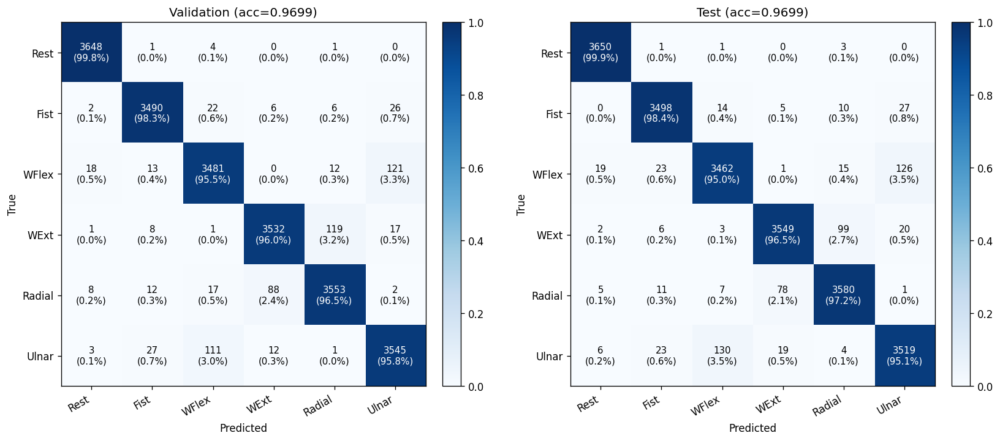
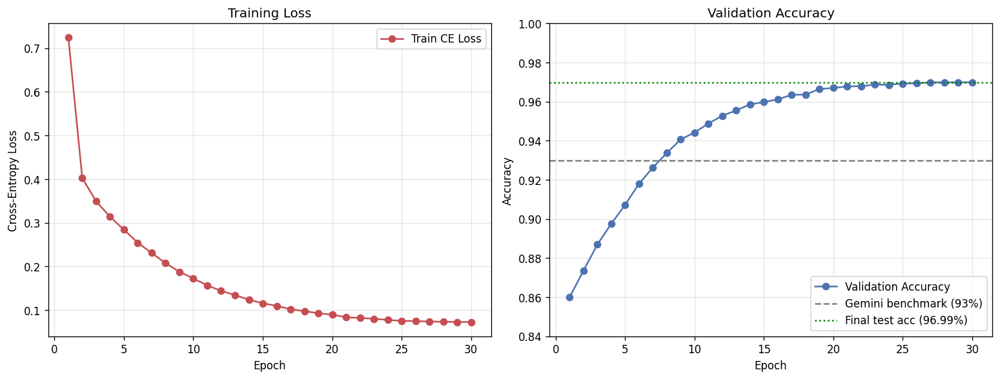
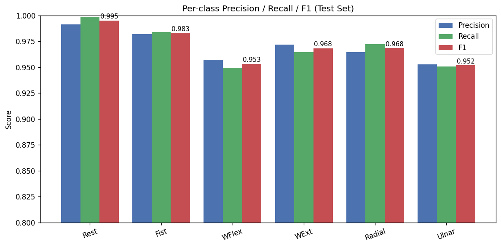
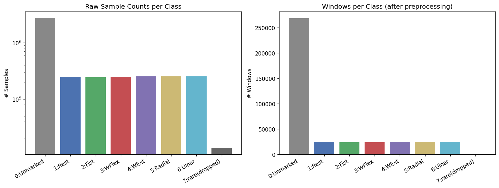

# emg_gesture_ai_classifier

다양한 AI로 만든 EMG 제스처 판별 모델입니다. 같은 데이터셋(UCI EMG Data for Gestures, 8채널 sEMG, 36명)의 손동작 분류를 세 가지 AI 작업 환경에서 풀어 보고 비교했습니다.

**결론: 숫자만 보면 Cowork(Claude) 96.99%가 가장 높지만, 이 순위를 성능 순위로 읽으면 안 됩니다.** 세 접근은 평가 방식이 다릅니다. 96%대 두 결과는 같은 피험자의 겹치는 윈도우가 학습과 평가에 함께 들어갑니다. 처음 보는 피험자로 평가한 값은 Gemini(chat) + 본인의 93.18%이고, 이 값도 모델 선택에 쓴 검증 데이터의 수치입니다. 세 방식을 같은 조건으로 다시 평가하지는 않았습니다.

코드와 상세 문서는 [`emg-gesture-classification/`](emg-gesture-classification/)에 있습니다.

## 결과

| 접근법 | 작업 방식 | 모델 | 윈도우 / step | 평가 분할 | 평가 클래스 수 | 평가 윈도우 | **정확도** |
|---|---|---|---|---|---|---|---|
| Gemini(chat) + 본인 v1 | 사람이 LLM과 대화하며 작성 | 1D-CNN | 64 / 32 | 피험자 분리 (1~30 / 31~36) | 6 (검증에 class 7 없음) | 7,597 | **91.51%** |
| Gemini(chat) + 본인 v2 | 같음 | 1D-CNN + BiLSTM | 128 / 64 | 피험자 분리 (1~30 / 31~36) | 6 (검증에 class 7 없음) | 3,769 | **93.18%** |
| Antigravity(Gemini) | 에이전트가 스크립트 작성·실행 | 1D-CNN | 200 / 50 | 윈도우 무작위 8:2 | 7 | 5,360 | **96.08%** |
| Cowork(Claude) | 에이전트가 전처리·학습·평가 수행 | 수공 특징 + MLP (numpy만) | 50 / 10 | 윈도우 무작위 70/15/15 | 6 | 21,917 | **96.99%** |

Gemini(chat) + 본인은 표에서 "검증" 정확도이고, Antigravity(Gemini)도 평가 데이터로 최고 모델을 골랐습니다. Cowork(Claude)만 검증(96.99%)과 시험(96.99%)을 분리했습니다.

### 왜 바로 비교할 수 없나

- **피험자 분리 (Gemini(chat) + 본인):** 학습에 안 쓴 피험자 6명으로 평가합니다. 새 사용자 상황에 더 가깝습니다. 단 피험자별 Z-score를 그 피험자 전체 데이터로 계산하므로, 새 사용자의 데이터 통계가 먼저 필요합니다.
- **윈도우 무작위 (Antigravity(Gemini), Cowork(Claude)):** 같은 피험자의 데이터가 학습과 평가에 섞입니다. 윈도우도 75~80% 겹치므로 거의 같은 구간이 양쪽에 들어갈 수 있습니다. Cowork(Claude)는 피험자 one-hot도 입력으로 받습니다. Cowork(Claude)의 97%는 이런 평가 조건의 이득이 일부 포함된 숫자입니다.
- **클래스 구성:** 세 접근 모두 class 0을 뺐습니다. Cowork(Claude)는 희소한 class 7도 뺐고, Gemini(chat) + 본인은 코드상 7클래스지만 31~36번 피험자에 class 7이 없어 실제 평가는 6클래스입니다. Antigravity(Gemini)의 class 7은 평가 49건뿐입니다.
- **윈도우 길이:** 50~200샘플로 달라 입력 정보량도 다릅니다.

## 문제와 데이터

[UCI EMG Data for Gestures](https://archive.ics.uci.edu/dataset/481/emg+data+for+gestures): MYO 암밴드 8채널 sEMG, 36명, 4,237,907행. 피험자마다 trial 2개가 있습니다. 용량 문제로 레포에 포함하지 않았습니다.

| class | 의미 | 행 수 | 처리 |
|---|---|---|---|
| 0 | Unmarked (라벨 없는 구간) | 2,725,157 (64%) | 모두 제외 |
| 1 | Hand at rest | 250,055 | 사용 |
| 2 | Hand clenched in a fist | 243,193 | 사용 |
| 3 | Wrist flexion | 249,494 | 사용 |
| 4 | Wrist extension | 251,570 | 사용 |
| 5 | Radial deviation | 251,733 | 사용 |
| 6 | Ulnar deviation | 253,009 | 사용 |
| 7 | 희소 라벨 | 13,696 (0.3%) | Cowork(Claude)만 제외 |

## 방법과 파이프라인

| 항목 | Gemini(chat) + 본인 v1 | Gemini(chat) + 본인 v2 | Antigravity(Gemini) | Cowork(Claude) |
|---|---|---|---|---|
| 코드 | `01_gemini/emg_gesture_gm_v1.ipynb` | `01_gemini/emg_gesture_gm_v2.ipynb` | `02_antigravity/` | `03_claude_cowork/src/` |
| 라이브러리 | PyTorch | PyTorch | PyTorch, sklearn | numpy, pandas, matplotlib |
| 정규화 | 피험자별 Z-score | 피험자별 Z-score | 학습 데이터 전체 기준 StandardScaler | 피험자별(학습 통계) + 전역 표준화 |
| 입력 | 원신호 8채널 | 원신호 8채널 | 원신호 8채널 | 수공 특징 220 + 피험자 one-hot 37 |
| 구조 | Conv 32→64→128 | Conv 32→64→128 + BiLSTM 2층 | Conv 128→256→512 + Dense 1024 | MLP 768→384→192→6 |
| 손실 | CrossEntropy | CrossEntropy + label smoothing 0.1 | CrossEntropy | CrossEntropy |
| 최적화 | AdamW + Cosine | AdamW + Cosine | Adam + ReduceLROnPlateau | numpy로 구현한 Adam + Cosine |
| 학습 | 15 epoch (조기 종료) | 14 epoch (조기 종료) | 최대 40 epoch | 30 epoch |

Cowork(Claude) 환경에서는 라이브러리 설치가 막혀 있어, forward, backward, Adam을 numpy로 직접 구현했습니다. 특성은 채널당 시간 영역 16개(MAV, RMS, WL, ZC, SSC, Hjorth 등), 주파수 영역 7개(rFFT 밴드 파워 등), 채널 쌍 상관 28개입니다.

## 상세 결과

### Gemini(chat) + 본인 v1 → v2

| 지표 | v1 | v2 | 비고 |
|---|---|---|---|
| 검증 정확도 | 91.51% | 93.18% | +1.67%p |
| macro-F1 | 0.7840 | 0.9314 | v1은 평가 건수 0인 class 6이 F1 0으로 포함돼 낮게 나옵니다. 실제 개선폭이 아닙니다 |

v2는 구조와 윈도우 길이를 함께 바꿨고 평가 윈도우 수도 다릅니다. +1.67%p 중 어느 것의 효과인지 나누지 못했습니다. 두 버전 모두 클래스 2, 5의 F1이 상대적으로 낮습니다(v2 0.89, 0.90).

### Antigravity(Gemini)

클래스별 F1은 0.94~0.99입니다. 평가 데이터 5,360건에서 고른 최고 epoch의 값입니다. `train.py`가 만드는 혼동행렬 이미지는 레포에 없습니다.

### Cowork(Claude)

학습 102,249 / 검증 21,908 / 시험 21,917 윈도우, 시험 정확도 96.99%, macro-F1 0.970.



| 클래스 | Precision | Recall | F1 |
|---|---|---|---|
| Hand at rest | 0.991 | 0.999 | 0.995 |
| Hand clenched (fist) | 0.982 | 0.984 | 0.983 |
| Wrist flexion | 0.957 | 0.950 | 0.953 |
| Wrist extension | 0.972 | 0.965 | 0.968 |
| Radial deviation | 0.965 | 0.972 | 0.968 |
| Ulnar deviation | 0.953 | 0.951 | 0.952 |

오류는 wrist flexion ↔ ulnar deviation(126건, 130건)과 wrist extension ↔ radial deviation(99건, 78건)에 몰려 있습니다.

| | |
|---|---|
|  학습 곡선 (그래프의 Gemini(chat) + 본인 93% 선은 평가 조건이 다른 참고값) |  클래스별 지표 |
|  클래스 분포 | |

## 시행착오와 실패한 시도

**Cowork(Claude)** (38% → 97%, 회고: [`velog_post.md`](emg-gesture-classification/03_claude_cowork/docs/velog_post.md))

| 단계 | 변경 | 정확도 (회고 기준 근사치) |
|---|---|---|
| 1 | 역빈도 가중 CE를 균등 CE로 변경. 가중 CE에서는 class 0만 답할 때의 64.7%보다도 낮았음 | 38% → 69% |
| 2 | 4-layer MLP + 더 많은 epoch | 69% → 74% |
| 3 | class 0 제거. 혼동행렬에서 class 1 재현율이 0%인 것을 보고 라벨 정의를 다시 확인 | 74% → 89% |
| 4 | 피험자별 표준화 + 피험자 one-hot | 89% → 94% |
| 5 | FFT 밴드 파워 + 학습 시간 확대 | 94% → 97% |

3단계의 +15%p는 같은 문제의 개선이 아닙니다. 모호한 class 0을 빼면서 문제 자체가 쉬워진 값입니다. 다만 라벨 정의를 먼저 읽어야 한다는 점은 확인했습니다.

**Gemini(chat) + 본인**

- v1 CNN은 15 epoch에서 조기 종료됐고, 시야를 넓히려고 v2에서 윈도우를 128로 늘리고 BiLSTM을 더했습니다.
- v2는 4 epoch에서 최고(93.18%)가 나온 뒤 10 epoch 동안 개선되지 않아 14 epoch에 멈췄습니다.

**Antigravity(Gemini)**

- 실패한 시도나 중간 실험 기록은 레포에 남아 있지 않습니다.

## 이 비교에서 본 것

1. **에이전트의 숫자는 평가 설계와 같이 읽어야 합니다.** 이번 비교에서 사람이 흐름을 통제한 Gemini(chat) + 본인 작업은 피험자 분리를 썼고, 두 에이전트는 별도 지시 없이 무작위 분할을 택했습니다. 한 번씩의 비교라 일반적인 경향이라고 말할 수는 없습니다.
2. **환경 제약이 다른 해법을 낳았습니다.** Cowork(Claude)는 라이브러리 설치가 막혀 수공 특징 + MLP로 갔습니다.
3. **라벨 정의를 이해하는 일이 모델 변경만큼 중요했습니다.** class 0과 class 1의 의미 중복은 혼동행렬을 본 뒤에야 알았습니다.
4. **큰 모델과 작은 모델의 정확도가 비슷했습니다.** 다만 윈도우 겹침 때문에 어려운 일반화를 보여 주는 결과는 아닙니다.

## 한계

- **공통 평가가 없습니다.** 같은 분할과 클래스로 세 모델을 다시 평가하지 않았습니다. 후속으로는 세 방식을 피험자 분리 6클래스로 통일해 비교해야 합니다.
- **윈도우 겹침으로 인한 누수 가능성이 있습니다.** Antigravity(Gemini)와 Cowork(Claude)의 정확도는 새 사용자는 물론, 같은 사용자의 새 세션 성능으로도 보기 어렵습니다.
- **Gemini(chat) + 본인의 독립 시험 데이터가 없습니다.** 조기 종료와 평가에 같은 6명을 사용했고, 6명이라 피험자 편차에도 민감합니다.
- **Gemini(chat) + 본인 윈도우가 trial 경계를 넘을 수 있습니다.** 피험자와 동작별로 이어 붙인 뒤 윈도우를 잘라, 떨어진 구간이 한 윈도우에 들어갈 수 있습니다.
- **단일 실행 결과입니다.** 반복 실행이나 신뢰구간이 없고, Gemini(chat) + 본인과 Antigravity(Gemini)는 학습 seed를 고정하지 않았습니다.
- **Cowork(Claude) 모델은 학습에 없는 피험자에게 그대로 쓸 수 없습니다.** 피험자 one-hot과 피험자별 표준화에 의존합니다.
- **산출물의 작성 주체가 다릅니다.** 에이전트 폴더의 코드와 문서(`velog_post.md` 포함)는 에이전트가 만든 내용을 바탕으로 합니다. 예를 들어 회고의 "표준 벤치마크 프로토콜"이라는 표현은 원문으로 따로 확인하지 못해 여기서 쓰지 않았습니다.
- **이번 문서 보완 때 다시 실행하지 않았습니다.** 원본 CSV가 없어, 위 수치는 노트북 출력과 `report.txt`, `final_metrics.json`의 저장 결과와 대조한 값입니다.

## 재현 방법

[UCI 페이지](https://archive.ics.uci.edu/dataset/481/emg+data+for+gestures)의 데이터를 합쳐 `time, channel1~8, class, label` 형식의 `EMG-data.csv`를 만듭니다.

**Gemini(chat) + 본인**: `/workspace/medical_datasets/EMG-data.csv` 경로와 GPU를 가정합니다. 경로를 바꾸고 셀을 순서대로 실행합니다.

**Antigravity(Gemini)**: `EMG-data.csv`를 실행 폴더에 둡니다.

```bash
cd emg-gesture-classification/02_antigravity
pip install pandas numpy scikit-learn torch matplotlib seaborn
python3 preprocess.py
python3 train.py
```

**Cowork(Claude)**: `data/EMG-data.csv`에 둡니다.

```bash
cd emg-gesture-classification/03_claude_cowork
pip install -r requirements.txt
python src/preprocess.py
python src/train.py --epochs 30
python src/evaluate.py
```

## 폴더 구조

```
README.md                            이 문서
emg-gesture-classification/
├── README.md                        3개 환경 비교 원문
├── 01_gemini/                       Gemini(chat) + 본인 (주피터 노트북 직접 작성)
│   ├── README.md                    v1·v2 상세
│   ├── emg_gesture_gm_v1.ipynb      1D-CNN (91.51%)
│   └── emg_gesture_gm_v2.ipynb      CNN + BiLSTM (93.18%)
├── 02_antigravity/                  Antigravity(Gemini) 에이전트
│   ├── README.md
│   ├── preprocess.py
│   ├── train.py                     1D-CNN (96.08%)
│   └── report.txt                   클래스별 결과
└── 03_claude_cowork/                Cowork(Claude) 에이전트
    ├── README.md
    ├── requirements.txt
    ├── src/                         preprocess.py, train.py, evaluate.py
    ├── results/                     그림 4장 + final_metrics.json (96.99%)
    ├── data/README.md               데이터 안내
    └── docs/velog_post.md           시행착오 회고
```

## 데이터셋 출처

> Lobov, S., Krilova, N., Kastalskiy, I., Kazantsev, V., & Makarov, V. A. (2018).
> Latent factors limiting the performance of sEMG-interfaces.
> Sensors, 18(4), 1122.

## 관련 레포

- [ninapro-db2-gesture](https://github.com/asclepios-jw/ninapro-db2-gesture) — 이 실험 뒤에 진행한 Ninapro DB2 50가지 손동작 분류 프로젝트

## License

MIT
